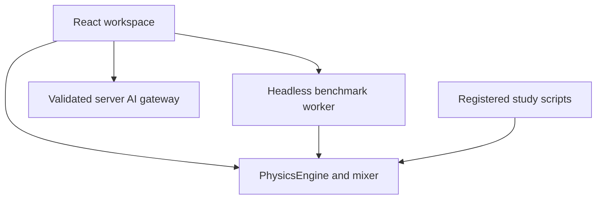

# Copter Studios

Browser-based drone simulation, reproducible controller evaluation and a bounded
AI planning assistant. [Live demo](https://copterstudios.com) ·
[Report feedback](https://github.com/saipavantejak/copter-studio/issues/new)

## Results at a glance

**211 software tests pass** in the recorded reliability run
(`reports/reliability-v3.json`); CI reruns tests, type checks, build and independent
claim verification. The live site runs the baseline controller. Changes on this
branch are local and have not been deployed.

The preregistered study evaluated 6
candidates with 3 independent training seeds each. Selection
used validation only. The selected candidate used 3000 training
episodes per seed; the final test used 200 shared episode seeds per scenario.
Baseline has 200 unique flights per scenario; policy aggregates pool
600 flights from 3 training runs, not
that many independent training units. Every controller completed all held-out
missions; this mild wind benchmark demonstrates no wind-robustness gain.

| Scenario | Reward baseline / policy | Reward difference, 95% crossed CI | Multiplicity-adjusted reward CI | Altitude error baseline / policy (m) | Altitude-error difference (m), 95% crossed CI |
|---|---|---|---|---|---|
| Calm | -27.05 / -23.41 | 3.6352 [2.1153, 5.0684] | [1.9415, 5.2358] | 0.0257 / 0.0218 | -0.0039 [-0.0053, -0.0025] |
| Mild synthetic wind | -29.42 / -25.19 | 4.2335 [2.8265, 5.5405] | [2.6316, 5.6877] | 0.0280 / 0.0235 | -0.0045 [-0.0058, -0.0032] |

Differences are policy minus baseline. Reward intervals adjusted to
97.5% account for both final
scenarios. Error intervals are descriptive, not additional corrected hypothesis
tests. Crossed bootstrap resamples training seeds and paired episode seeds.
Absolute means and comparison intervals come from `reports/study/final.json`;
`verify-study-independent.mjs` recomputes them from raw records. See
[all candidate results](reports/study/improvement-study.md) and
[claim checks](reports/integrity/claim-to-source.csv).

### Limitations

- Simulation only: physicalValidation=false and promoted=false. A simulation gate pass did not install the learned policy.
- The measured altitude effect is small; candidate f bundles episode budget and learning-rate schedule. Their contributions have not been separated.
- Few independent training runs limit interval coverage; no universal performance guarantee is supported.
- Mild synthetic wind uses a geometry-based drag proxy; it is not measured gust calibration and the baseline success rate is saturated.
- In-repository training data contain static bench measurements and energy summaries, not time-aligned flight logs.
- External Brushless flight logs yielded poor longer-horizon agreement. [The diagnostic](reports/physics/comparison.md) bypasses actuator, aerodynamic, battery, sensor and controller dynamics and does not validate the brushed study configuration.
- Historical inventory rows marked UNVERIFIED are not numeric certifications. No follow-up ablation or matched PPO comparison was performed in this round.
- Lighthouse measurement was invalid in this environment. No performance score or before/after timing improvement is claimed.

## Architecture



The physics primitives are shared by browser, worker and Node evaluation.
Aether proposes a bounded plan; local validation and user approval precede
execution. Gemini credentials stay server-side. Optional cloud failures do not
change the study result or authorize hardware actions.
[Security and key exposure evidence](docs/SECURITY.md) ·
[Interview guide](docs/INTERVIEW.md) · [Errata](docs/ERRATA.md).

## Run and verify

```sh
npm ci
npm run dev
npm test
npm run lint
npm run type-check:server
npm run build
node scripts/learning/verify-study-independent.mjs
python scripts/learning/check-inventory.py
python scripts/docs/render-project.py --check
```

The final seed bank is consumed. Do not rerun training/selection/final commands
in this checkout. The deterministic replay helper uses frozen historical source
in clean worktrees and does not tune or select a controller.

## Demo capture

A capture generator is provided instead of an invented screenshot or recording:

```sh
npm run build
npx playwright install chromium
node scripts/product/capture-demo.mjs
```

It hosts the production build and browser together, records actual scripted
interaction and writes `reports/product/demo.webm`. Cloud AI is unavailable in
this isolated preview; no login, real API key or training is needed. A capture
has not been generated in this environment. A recording error must be reported,
not replaced with fabricated footage.

## Study detail

<!-- BEGIN GENERATED ML EVALUATION -->
## Pre-registered ML improvement study

**Conclusion A.** A: the selected candidate passes the unchanged simulation gate on fresh data, with the predeclared final evidence requirement also satisfied. Physical promotion remains false.

Registration was committed before experiments: `bf89608`. The physically scaled wind correction was committed separately as `57fe174`, using manufacturer dimensions, a declared flat-plate drag proxy and relative airspeed. It is not measured aerodynamic calibration. Baseline qualification was 100/100 missions with 0 engine failures, so the registered mild-wind scenario was retained without further modification.

Six one-factor candidates were evaluated, each with three training seeds. Validation used 500001–500100 (calm) and 501001–501100 (wind), with Bonferroni correction across twelve primary candidate/scenario comparisons. No consumed legacy/audit banks were used for tuning. Candidate **f (3000 episodes and visit-decaying alpha)** was selected by the committed validation-only rule. The final test used 600001–600200 / 601001–601200 exactly once, with no subsequent tuning.

| Scenario | Baseline reward | Policy reward | Reward Δ | 95% crossed CI | Two-scenario 97.5% CI | Baseline / policy altitude error (m) | Baseline / policy successes | Engine failures |
|---|---|---|---|---|---|---|---|---|
| Calm | -27.050001 | -23.414768 | 3.635233 | [2.115323, 5.068377] | [1.941497, 5.235808] | 0.025703 / 0.021802 | 200/200 / 600/600 | 0/200 / 0/600 |
| Wind | -29.419173 | -25.185662 | 4.233511 | [2.826502, 5.540468] | [2.631572, 5.687716] | 0.028017 / 0.023495 | 200/200 / 600/600 | 0/200 / 0/600 |

Policy figures pool three trained policies sharing 200 episode seeds per scenario; repeated baseline observations are not treated as independent. The ordinary 95% and two-scenario-adjusted reward intervals use a crossed bootstrap over training seeds and episode seeds. Only three training seeds limit the accuracy of interval coverage.

Simulation only; `physicalValidation=false`, `passesSimulationGate=true`, `promoted=false`. The success criteria, original reward and per-run promotion gate are unchanged. Physics was frozen after the required calibration commit. A shorter-hold candidate retains the same decision-level gamma, so its temporal discount horizon also changes. No severe-wind, flight robustness or endurance claim is supported.

All six validation results, per-run final outcomes, calibration sources, registered selection and reproduction commands are in [the study audit](reports/study/improvement-study.md). The audit-era results are preserved separately. The final artifact is [residual-policy.json](public/learning/residual-policy.json).

<!-- END GENERATED ML EVALUATION -->
